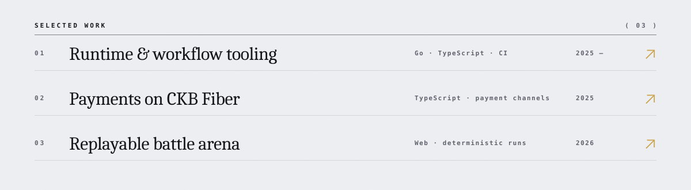
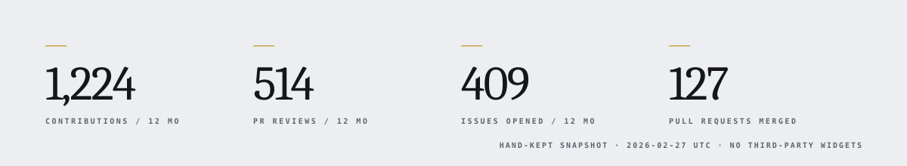

<!-- Akane-CN · profile README · assets are built by tools/build_assets.py -->

  

 

Akane is twenty, lives in Japan, and builds the quiet parts of software: the backends, the pipelines, the tooling that nobody notices until it breaks. She likes small pull requests, strict CI and logs that tell the truth. Her working rule fits in six characters, 速く、でも丁寧に. Fast, but precise.

  

  
    <a href="https://github.com/Keith-CY/carrier">carrier</a>&nbsp;&nbsp;·&nbsp;&nbsp;
    <a href="https://github.com/Keith-CY/fiber-link">fiber-link</a>&nbsp;&nbsp;·&nbsp;&nbsp;
    <a href="https://war.md">war.md</a>
  

 

## How she works

**Ship, measure, improve.** Momentum beats perfection. Evidence beats opinion.

**Boring is a feature.** Timeouts, retries, idempotency, rollbacks. If it isn't observable, it isn't done.

**Logs over guesses.** ログは嘘をつかない. She reads them for fun, and will read yours.

**Written for 3 AM.** Runbooks a tired on-call engineer can follow without waking her up.

 

  

 

## Stack

`Go` `TypeScript` `SQL` `Node.js` `Bun` `Docker` `GitHub Actions`

## Off the clock

Coffee, terminals, anime, synthwave at 2× speed. Reads logs for fun. Refuses to deploy on Fridays.

 

  

