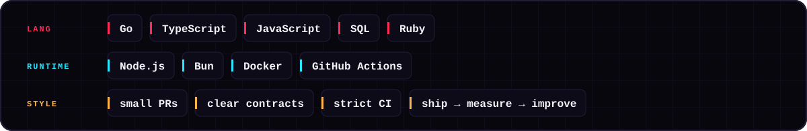
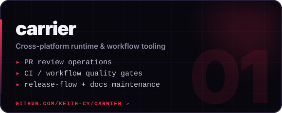
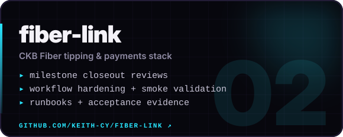
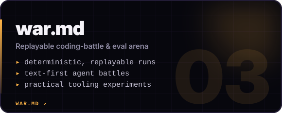
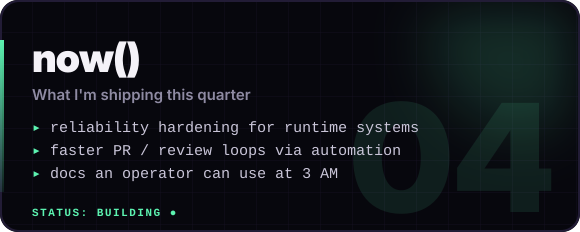

<!-- Akane-CN · profile README · every image is a self-contained SVG built by tools/build_assets.py -->

<p align="center">
  
</p>

<p align="center">
  <a href="https://github.com/Keith-CY/carrier"><b>carrier</b></a>&nbsp;&nbsp;·&nbsp;&nbsp;
  <a href="https://github.com/Keith-CY/fiber-link"><b>fiber-link</b></a>&nbsp;&nbsp;·&nbsp;&nbsp;
  <a href="https://war.md"><b>war.md</b></a>
</p>

<br/>

## こんにちは 👋 I'm Akane.

**20 y/o, Japan, terminal-native.** I build backend systems and the tooling around them, then make sure they survive production: timeouts, retries, rollbacks, observability. The boring parts. The parts that page someone at 3 AM when nobody cared.

My job, as I see it: **turn messy workflows into clean, deterministic pipelines**, and leave behind docs an operator can actually use.

```text
$ akane --whoami

  name       Akane // 茜
  base       Japan · UTC+9
  stack      Go · TypeScript · SQL · CI
  does       backend · infra · devtools · reliability
  believes   boring systems are beautiful systems
  mode       速く、でも丁寧に  (fast, but precise)
  status     building ●
```

<p align="center">
  
</p>

## Featured work

<table>
  <tr>
    <td width="50%"><a href="https://github.com/Keith-CY/carrier"></a></td>
    <td width="50%"><a href="https://github.com/Keith-CY/fiber-link"></a></td>
  </tr>
  <tr>
    <td width="50%"><a href="https://war.md"></a></td>
    <td width="50%"></td>
  </tr>
</table>

## How I work

<table>
  <tr>
    <td><b>Ship → measure → improve</b></td>
    <td>Small PRs, clear contracts, strict CI. Momentum beats perfection, evidence beats opinion.</td>
  </tr>
  <tr>
    <td><b>Boring is a feature</b></td>
    <td>Timeouts, retries, idempotency, rollbacks. If it isn't observable, it isn't done.</td>
  </tr>
  <tr>
    <td><b>Logs &gt; guesses</b></td>
    <td>ログは嘘をつかない — logs don't lie. I read them for fun, and I'll read yours too.</td>
  </tr>
  <tr>
    <td><b>Write for 3 AM</b></td>
    <td>Runbooks and checklists a tired on-call engineer can follow without pinging me.</td>
  </tr>
</table>

## Snapshot

<p align="center">
  
</p>

<p align="center">
  <sub>Hand-maintained snapshot, no third-party stats widgets. Last refresh: 2026-02-27 UTC.</sub>
</p>

## Off the clock

- Anime aesthetics, cyberpunk UI, synthwave at 2× speed.
- Coffee + terminal = a good night.
- Yes, I still read logs for fun.

## Let's build

Working on infra, devtools, or payment workflows? Open an issue on any project above, or just say hi.

<p align="center">
  
</p>
